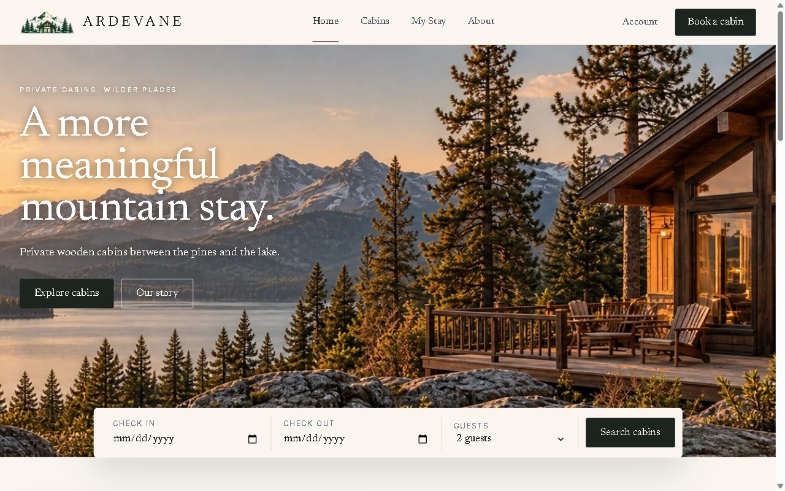
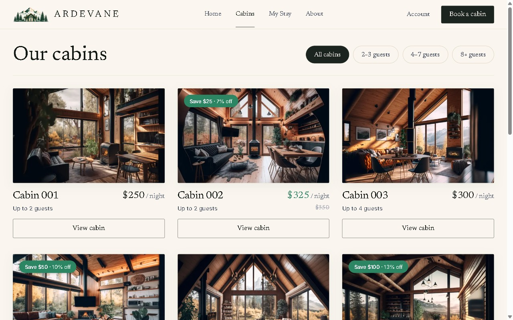
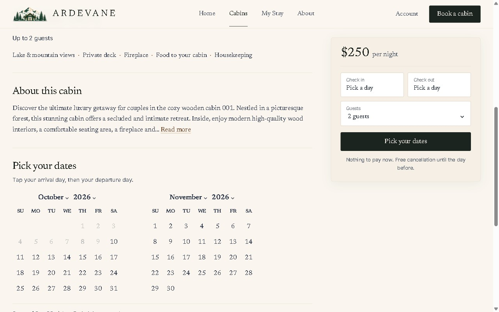
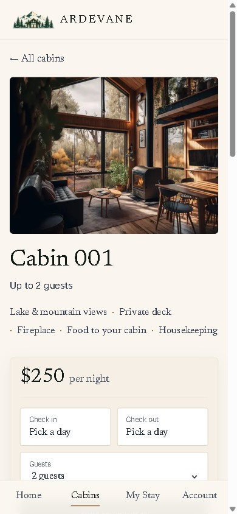

# Ardevane Guest Website

The guest-facing side of Ardevane, a cabin hotel system made of two applications on one Supabase database. Guests browse the cabins, pick dates, send a reservation request, manage their stays and, once checked in, order food and ask for things from their cabin. The staff side is [Ardevane Operations](https://github.com/ahmedmoh14314-code/ardevane-operations); both apps read and write the same database.

Next.js 14 App Router · React 18 · Supabase · Tailwind CSS

## Live demo

**https://ardevane.netlify.app**

Browsing the cabins, picking dates and seeing the price need no account. To send a reservation request, sign in with a Google account. Email sign-up is wired but confirmation emails only go out to the project's own addresses until an email provider is connected, so Google is the way in for now.

There is no shared demo account yet.

## What this project demonstrates

- **Server and client split.** 25 of the 84 files under `app/` are client components; the rest render on the server. Pages read data in Server Components through `app/_lib/data-service.js`, with the visitor's own session when there is one.
- **Server Actions for every write.** `app/_lib/actions.js` holds booking, editing, cancelling, stay requests and sign-in. Each action calls a database function, returns an error as a value for the form to show, and redirects on success.
- **Authentication flow.** `middleware.js` refreshes the Supabase session cookie on every request and sends signed-out visitors from `/account` and `/my-stay` to `/login?next=…`. `app/auth/callback/route.js` turns the Google (or email link) code into a session. `safeNextPath` in `app/_lib/users.js` only allows a return path on this site.
- **Sign-in comes last.** Dates and guests live in a client Context backed by `sessionStorage`, and the review page reads the whole stay from the URL (`reviewPath` / `readReview` in `app/_lib/stay.js`), so nothing is lost on the round trip to Google.
- **Forms.** Native `<form action>` with Server Actions, a shared `SubmitButton` that uses `useFormStatus` for the pending state, hidden inputs carrying the stay, and inline error messages that come from the database's own validation.
- **Routing.** Dynamic `/cabins/[cabinId]` pages built with `generateStaticParams` and revalidated hourly, `generateMetadata` per cabin, `loading.js`, `error.js` and `not-found.js` boundaries, and a redirect map in `next.config.mjs` for moved pages.
- **Streaming and URL state.** The cabins list renders inside `Suspense` keyed by the filter, and the size filter writes to the search params with `router.replace` so a filtered view can be linked.
- **A date picker with real rules.** `DateSelector` disables taken nights, enforces the hotel's minimum and maximum stay, and still lets a guest leave on the morning the next guest arrives. The logic lives in pure helpers in `app/_lib/stay.js`, which are unit tested.
- **Optimistic UI.** `ReservationList` uses `useOptimistic` so a cancelled reservation moves to the Cancelled tab before the server answers.
- **Images and fonts.** `next/image` with `sizes` on every image and blur placeholders on the local photos; self-hosted fonts through `next/font/local`.
- **Responsive layout.** A bottom tab bar on phones (`MobileTabBar`, with `aria-current`), a sticky booking card on wide screens, horizontal scroll rows for cabins and filters on small screens.
- **Accessibility that is actually there.** `aria-pressed` on filter pills, `role="tablist"` with `aria-selected` on the reservation tabs, `aria-label` on icon buttons, labelled form fields.
- **Tests.** 41 Vitest unit tests on the pure helpers: dates and availability, pricing, account state, requests and user mapping.

## Key decisions

- **Booking rules live in the database.** The browser sends a cabin, two dates and a guest count. `create_booking` re-checks the cabin, the stay length, the capacity and the free nights, and sets the price itself. An exclusion constraint makes overlapping stays in one cabin impossible even for two simultaneous requests.
- **No secret key on the website.** The app only ever acts as the anonymous visitor or the signed-in guest. Row-level security decides what each one can see or change.
- **One Supabase Auth for guests and staff.** Signing in gives no staff rights; staff are rows in `staff_members`. A guest reads and changes only their own profile, bookings, charges and requests.
- **The account follows the stay.** The same pages show a booking prompt, the next reservation, or My Stay depending on the booking's status (`pending`, `reserved`, `checked_in`, `checked_out`, `cancelled`, `no_show`).
- **Cancelling keeps the record.** A cancelled booking stays in the database with a `cancelled` status and frees its nights. Every booking has a short reference such as `ARD-7K3Q9P`.
- **Sign out is local.** `signOut({ scope: "local" })`, so signing out of the website does not end the same person's session in the staff dashboard.

## Where to look

| File | What it shows |
| --- | --- |
| `app/_lib/actions.js` | Every Server Action: bookings, stay requests, sign-in, sign-up, sign-out |
| `middleware.js` | Session refresh and route protection |
| `app/_lib/stay.js` + `stay.test.js` | Availability and date-range logic, pure and tested |
| `app/_components/DateSelector.js` | The calendar rules in the UI |
| `app/_components/ReservationContext.js` | Picked dates surviving a sign-in redirect |
| `app/reserve/page.js` | The review step: everything read from the URL, price quoted by the database |
| `app/cabins/[cabinId]/page.js` | Static params, metadata, parallel data loading |
| `app/_components/ReservationList.js` | `useOptimistic` cancel |
| `app/my-stay/page.js` | A page whose content depends on where the guest is in their stay |

## How the two apps connect

The applications never talk to each other directly. They share one database:

- A reservation request from the website appears in Operations as `pending`; approving it makes it `reserved` and the guest sees the change.
- Staff check the guest in and the guest's account switches to My Stay.
- A food order or housekeeping request lands in the Operations request queue.
- Staff mark a food order delivered and one charge appears under the guest's charges.

Tables, policies, booking functions and triggers are defined by the migrations in the Operations repository. This site only reads tables and calls those functions.

## Screenshots

Taken from the live site.

| Home | Cabins |
| --- | --- |
|  |  |

| Cabin page with the calendar | On a phone |
| --- | --- |
|  |  |

## Tech stack

- Next.js 14 (App Router, Server Components, Server Actions, middleware)
- React 18
- Supabase: PostgreSQL, Auth, Storage, with `@supabase/ssr` for the server session
- Tailwind CSS
- date-fns and react-day-picker
- Vitest

## Project structure

```
app/
├── _components/   client and server components (ReservationContext, DateSelector, …)
├── _lib/          data-service.js (reads), actions.js (writes), auth.js, stay.js, pricing.js
├── _lib/supabase/ server.js (with session) and public.js (anonymous)
├── cabins/        listing, [cabinId] page, loading and not-found
├── reserve/       the review step
├── account/       reservations, profile
├── my-stay/       stay hub and dining menu
├── auth/callback/ OAuth and email-link callback
└── login, signup, about, api/cabins/[cabinId]
middleware.js
```

## Running locally

```bash
npm install
cp .env.example .env.local   # Supabase URL and publishable key
npm run dev                  # http://localhost:3000
npm test
```

The database comes from the Operations repository: apply its `supabase/migrations` to your project first. In the Supabase dashboard, add `http://localhost:3000/**` to the redirect URLs and enable the Google provider.
